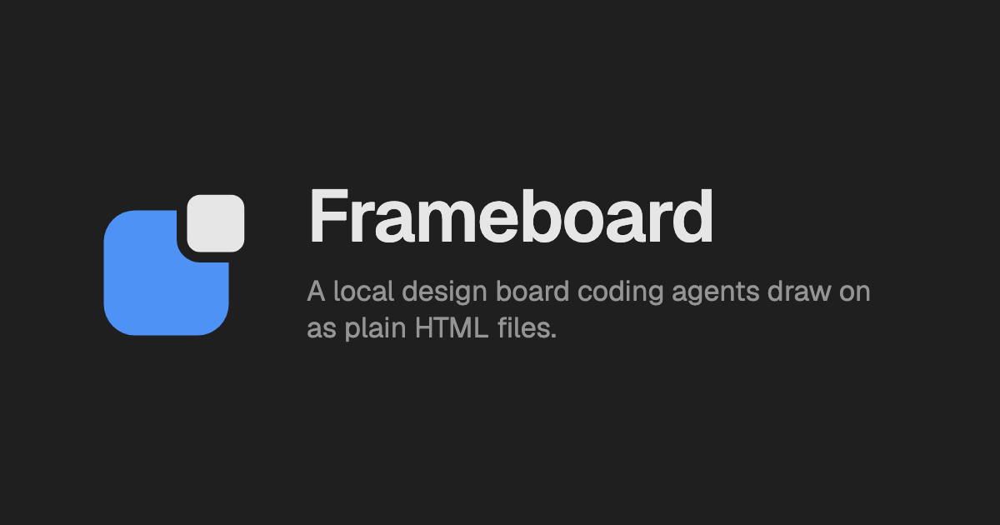

<p align="center">
  
</p>

# Frameboard

A local design board that coding agents draw on as plain HTML files, and you review and tweak.



## Quick start

```bash
npx frameboard serve
```

In a folder with no board, `serve` creates `.frameboard/` with one empty project and opens the board at `http://127.0.0.1:4173`. Install it with `npm install -g frameboard` or `bun add -g frameboard`.

## What you get

- Agents draw by writing HTML files and running commands that print JSON, exit with stable codes, and never prompt
- Frames render as real web pages, so animation, video, and interaction work
- Every frame reloads the moment its file changes, in light and dark
- The files are the design, so Frameboard keeps no private copy and a hand edit touches only what changed
- The server binds to `127.0.0.1`, with no hosted service and no MCP server

## How it works

A board folder holds projects, a project holds pages, and a page holds frames. Each frame is one `.html` file beside a `layout.json` that records where it sits.

The `project`, `page`, and `frame` commands manage them on disk, `list` shows the board, and `edit` changes one style, attribute, or text on one element without touching another byte. `show` points the open board at a frame.

`frameboard check` reports every content rule a frame breaks, such as a link outside its page folder or colors set for one theme alone, and exits 8 on any finding. The board runs the same rules on each change.

The Claude Code plugin in `plugins/frameboard/` runs the checks after each agent write and hands the findings back in the same turn. `frameboard docs` prints every command, flag, record shape, and exit code.

Releases before 1.0 ship the board in stages. Editing by hand in the board arrives in a later 0.x release.

## Requirements

Frameboard runs on macOS and Linux, with Node 22 or later or with Bun. Windows support is planned.

## Links

- [Contributing guide](CONTRIBUTING.md) for setup, tests, and the commit rules
- [Security policy](SECURITY.md) for reporting a vulnerability privately
- [Issue tracker](https://github.com/erclx/frameboard/issues)
- [MIT license](LICENSE)
