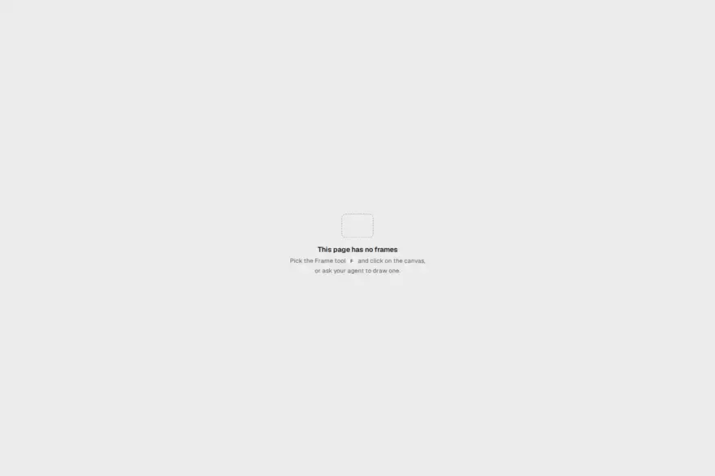

<p align="center">
  
</p>

# Frameboard

A local design board that coding agents draw on as plain HTML files, and you review and tweak.

<p align="center">
  <picture>
    <source media="(prefers-color-scheme: dark)" srcset=".github/readme-hero-dark.png">
    <source media="(prefers-reduced-motion: reduce)" srcset=".github/readme-hero-light.png">
    
  </picture>
</p>

## Quick start

```bash
npx frameboard serve
```

`serve` opens a board in your browser, in a tab that can edit. Point your coding agent at the same folder, and each frame it writes shows up as soon as the file lands.

To keep it around, install it with `npm install -g frameboard` or `bun add -g frameboard`.

## How it works

| 1. Your agent writes                                                                             | 2. The board shows it                                                                                      | 3. You steer                                                                       |
| ------------------------------------------------------------------------------------------------ | ---------------------------------------------------------------------------------------------------------- | ---------------------------------------------------------------------------------- |
| Each frame is one HTML file in a page folder, so your agent draws with the tools it already has. | A frame reloads the moment its file changes, in light and dark, and a broken rule is flagged on the frame. | Move, restyle, and retype by hand, or pin a note your agent answers in its thread. |

## For you

- You arrange pages, frames, and layers, and copy, paste, or undo across all of them
- You change text, shapes, color, and type by hand, picking colors from your project's tokens
- A note you pin on a frame or an element reaches your agent straight away

[Everything you can do on the board](docs/board.md)

## For your agent

- Commands print JSON and never prompt, so an agent can run them unattended
- `frameboard check` flags what breaks a frame, such as clipped text or a color set for one theme only
- The Claude Code plugin checks each frame the agent writes and hands it your notes as they arrive

[The command and check reference](docs/agents.md)

## Requirements

Frameboard runs on macOS and Linux, with Node 22 or later or with Bun. Windows support is planned.

`capture`, `frame fit`, `inspect`, and the home view's project thumbnails render in Playwright's headless shell. Without it, the commands print the command that installs it and download nothing, and each home card shows its frames as plain boxes.

## Links

- [How it works](docs/how-it-works.md) for the board folder, tokens, and themes
- [Contributing guide](CONTRIBUTING.md) for setup, tests, and the commit rules
- [Security policy](SECURITY.md) for reporting a vulnerability privately
- [Issue tracker](https://github.com/erclx/frameboard/issues)
- [MIT license](LICENSE)
