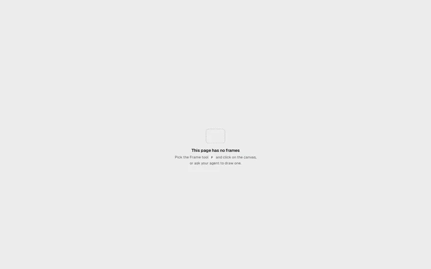
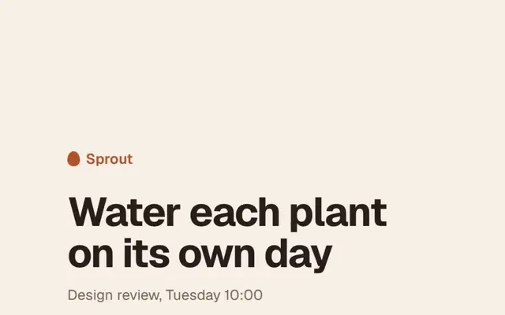
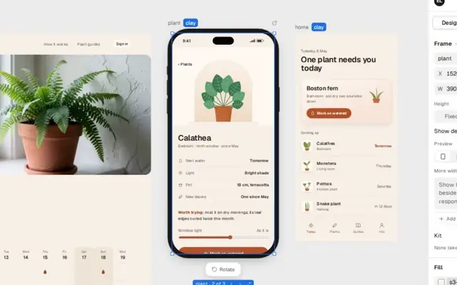
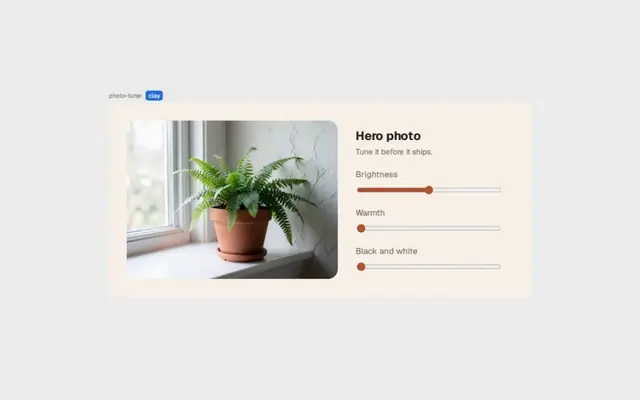
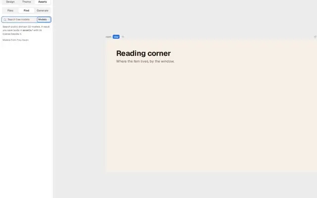
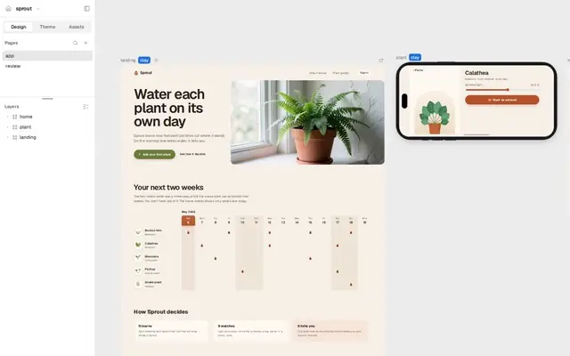
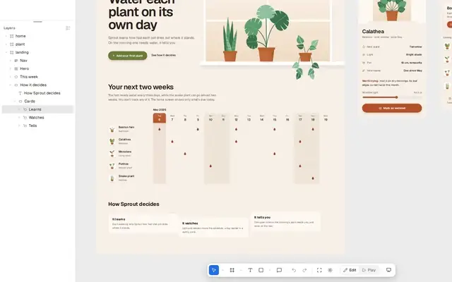

<div align="center">


# Frameboard

A local design board that coding agents draw on as plain HTML files, and you review and tweak.

[](https://www.npmjs.com/package/frameboard)
[](https://github.com/erclx/frameboard/actions/workflows/verify.yml)
[](package.json)
[](LICENSE)

</div>

<p align="center">
  <picture>
    <source media="(prefers-reduced-motion: reduce) and (prefers-color-scheme: dark)" srcset=".github/readme-hero-dark.png">
    <source media="(prefers-reduced-motion: reduce)" srcset=".github/readme-hero-light.png">
    <source media="(prefers-color-scheme: dark)" srcset=".github/readme-hero-loop-dark.webp">
    
  </picture>
</p>

## Quick start

```bash
npx frameboard serve
```

`serve` opens a board in your browser, in a tab that can edit. Point your coding agent at the same folder, and each frame it writes shows up as soon as the file lands.

To keep it around, install it with `npm install -g frameboard` or `bun add -g frameboard`.

## How it works

| 1. Your agent writes                                                                             | 2. The board shows it                                                                                      | 3. You steer                                                                       |
| ------------------------------------------------------------------------------------------------ | ---------------------------------------------------------------------------------------------------------- | ---------------------------------------------------------------------------------- |
| Each frame is one HTML file in a page folder, so your agent draws with the tools it already has. | A frame reloads the moment its file changes, in light and dark, and a broken rule is flagged on the frame. | Move, restyle, and retype by hand, or pin a note your agent answers in its thread. |

## What you can do

<table>
  <tr>
    <td width="50%">
      <picture>
        <source media="(prefers-reduced-motion: reduce)" srcset=".github/readme-themes/slides.jpg">
        
      </picture>
      <br><b>Slides</b><br>
      Present a page as slides, with transitions, steps inside a slide, speaker notes, and a presenter view in a second window.
    </td>
    <td width="50%">
      <picture>
        <source media="(prefers-reduced-motion: reduce)" srcset=".github/readme-themes/devices.jpg">
        
      </picture>
      <br><b>Devices</b><br>
      Put a frame in a phone, tablet, or foldable body, turn it landscape, and open the project on your own phone over the network.
    </td>
  </tr>
  <tr>
    <td width="50%">
      <picture>
        <source media="(prefers-reduced-motion: reduce)" srcset=".github/readme-themes/play.jpg">
        
      </picture>
      <br><b>Play</b><br>
      Click through a frame like the real app, tune the sliders your agent drew, and keep the values you set.
    </td>
    <td width="50%">
      <picture>
        <source media="(prefers-reduced-motion: reduce)" srcset=".github/readme-themes/images-3d.jpg">
        
      </picture>
      <br><b>Images and 3D</b><br>
      Find openly licensed images and 3D models, or generate them on your own machine, and each lands with its license.
    </td>
  </tr>
  <tr>
    <td width="50%">
      <picture>
        <source media="(prefers-reduced-motion: reduce)" srcset=".github/readme-themes/kits.jpg">
        
      </picture>
      <br><b>Design kits</b><br>
      Start a project from a kit you can preview, then give any frame a kit of its own.
    </td>
    <td width="50%">
      <picture>
        <source media="(prefers-reduced-motion: reduce)" srcset=".github/readme-themes/hand-edits.jpg">
        
      </picture>
      <br><b>Hand edits</b><br>
      Wrap several elements in a row, set its gap and fills by hand, and export any of it as a PNG.
    </td>
  </tr>
</table>

[Everything you can do on the board](docs/board/index.md)

## For your agent

- Commands print JSON and never prompt, so an agent can run them unattended
- `frameboard check` flags what breaks a frame, such as clipped text or a color set for one theme only
- The Claude Code plugin checks each frame the agent writes and hands it your notes as they arrive
- A claim reserves the frame an agent is about to write, so you see where it is drawing before the file lands
- `frameboard image` and `frameboard model` find or generate assets from the command line, each saved with its license

[The command and check reference](docs/agents/index.md)

## Requirements

Frameboard runs on macOS and Linux, with Node 22 or later or with Bun. Windows support is planned.

`capture`, `frame fit`, `inspect`, and the home view's project thumbnails render in Playwright's headless shell. Without it, the commands print the command that installs it and download nothing, and each home card shows its frames as plain boxes.

## Links

- [How it works](docs/how-it-works.md) for the board folder, tokens, and themes
- [Contributing guide](CONTRIBUTING.md) for setup, tests, and the commit rules
- [Security policy](SECURITY.md) for reporting a vulnerability privately
- [Issue tracker](https://github.com/erclx/frameboard/issues)
- [MIT license](LICENSE)
